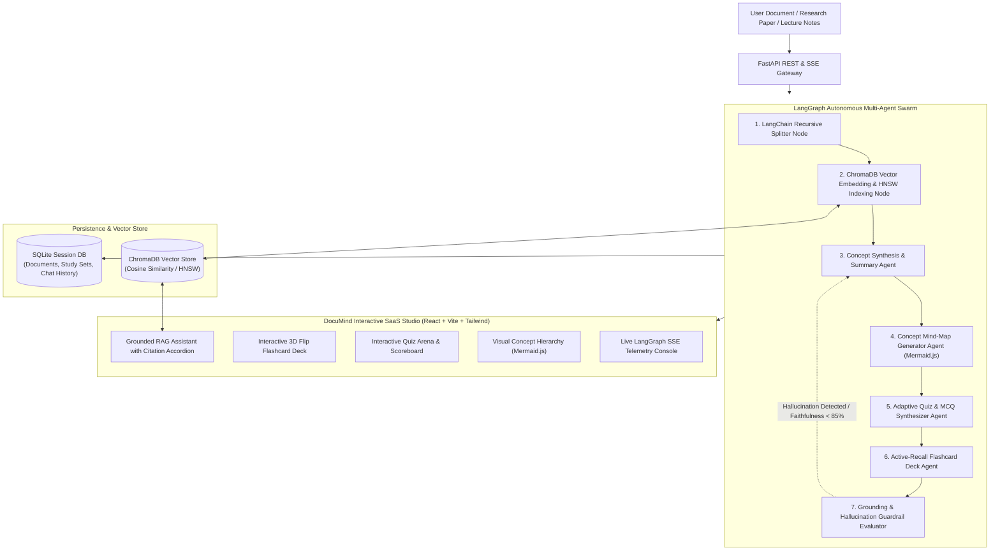

# DocuMind AI 📚⚡
> **Autonomous Multi-Agent Academic Research, Document Intelligence & Accelerated Learning Hub**  
> *Engineered with LangChain, LangGraph, ChromaDB Vector RAG, FastAPI, and React.*

[](https://fastapi.tiangolo.com)
[](https://langchain.com)
[](https://langchain-ai.github.io/langgraph/)
[](https://trychroma.com)
[](https://react.dev)
[](https://www.typescriptlang.org)
[](https://tailwindcss.com)
[](backend/tests)

---

## 🎓 Academic Capstone Overview & Problem Statement

University students, researchers, and software engineers spend hundreds of hours parsing dense academic papers, complex algorithmic proofs, and lengthy technical documentation. Standard LLM chatbots suffer from three fundamental limitations:
1. **Unverifiable Hallucinations**: Standard models hallucinate mathematical proofs and paper citations without strict grounding.
2. **Passive Consumption**: Chatbots output monolithic walls of text rather than structured active-recall study aids (spaced repetition flashcards, interactive quizzes, concept mind-maps).
3. **Lack of Agent State Coordination**: Single-prompt LLM calls cannot self-correct, cross-verify claims, or maintain state machines across document ingestion pipelines.

**DocuMind AI** solves this problem by coordinating an autonomous **LangGraph StateGraph multi-agent swarm** backed by a persistent **ChromaDB vector database**. It transforms any research paper, textbook chapter, or lecture note into:
- 📖 **Executive Synthesis**: Concise, grounded summaries and key technical concepts.
- 🗂️ **Interactive 3D Active-Recall Flashcards**: Card deck with 3D flip animations and difficulty tracking.
- 🎯 **Adaptive Practice Quiz Arena**: Multiple-choice assessment questions with real-time scoring and answer explanations.
- 🗺️ **Visual Concept Mind-Maps**: Interactive Mermaid.js concept hierarchy trees mapping parent-child structural relationships.
- 💬 **Grounded RAG Assistant**: Document Q&A citing exact source chunks and similarity scores directly from ChromaDB.

---

## 🏛️ System Architecture



---

## 🤖 Multi-Agent Workflow Specification

DocuMind AI's LangGraph StateGraph pipeline executes in 7 coordinated phases:

| Phase | Agent Node | Core Responsibility | Technologies |
|---|---|---|---|
| **1** | `node_ingest` | Structural cleaning, whitespace normalization, and recursive chunking with character overlap. | LangChain Splitters |
| **2** | `node_vector_index` | Generates 128-dimensional dense semantic vectors and persists embeddings into ChromaDB collection. | ChromaDB PersistentClient |
| **3** | `node_synthesize` | Extracts foundational thesis, technical methodology, and high-frequency technical concepts. | LangChain Core |
| **4** | `node_mindmap` | Generates hierarchical Mermaid.js flowcharts mapping core concepts and sub-topics. | Mermaid.js Engine |
| **5** | `node_quiz` | Formulates 4-option MCQs targeting foundational knowledge and architectural interactions. | Heuristic & Neural Generator |
| **6** | `node_flashcards` | Synthesizes active-recall question/answer cards tagged by difficulty (Easy, Medium, Hard). | Spaced Repetition Logic |
| **7** | `node_guardrail` | Queries ChromaDB to cross-verify all extracted concepts against raw source chunks. Triggers self-healing reflection loops if confidence is below 85%. | Grounding Evaluator |

---

## ⚡ Interactive Features

- **Real-Time LangGraph Streaming (SSE)**: Visual progress bar and live terminal logs reflecting agent thought traces and state transitions.
- **Pre-Loaded Classical Academic Library**: Ingest and test foundational papers in one click:
  - *Attention Is All You Need (Transformers, Vaswani et al.)*
  - *Deep Residual Learning for Image Recognition (ResNet, He et al.)*
  - *Bitcoin: A Peer-to-Peer Electronic Cash System (Satoshi Nakamoto)*
- **Interactive 3D Flip Flashcard Deck**: Flip cards on click with 3D perspective animations, shuffle deck, and mark concepts as mastered.
- **Adaptive Practice Quiz Arena**: Instant color-coded feedback (green for correct, red for incorrect), explanation reveals, and accuracy scorecards.
- **Grounded Vector Citations**: Every RAG chat response displays exact document chunk numbers and cosine similarity scores.
- **Zero-Dependency Fallback**: Fully functional offline without third-party API keys; seamlessly enhances with Gemini/OpenAI API keys if provided.

---

## 📦 Project Directory Structure

```
DocuMind-AI/
├── backend/
│   ├── app/
│   │   ├── __init__.py
│   │   ├── main.py                  # FastAPI server, CORS, lifespan, routes
│   │   ├── config.py                # App configuration, directories, settings
│   │   ├── db/
│   │   │   ├── __init__.py
│   │   │   ├── session.py           # SQLite SQLAlchemy session
│   │   │   └── entities.py          # DocumentRecord, StudySetRecord, ChatHistoryRecord
│   │   ├── schemas/
│   │   │   ├── __init__.py
│   │   │   └── models.py            # Pydantic v2 schemas for all payloads
│   │   ├── services/
│   │   │   ├── __init__.py
│   │   │   ├── document_loader.py   # LangChain recursive character splitter
│   │   │   └── rag_engine.py        # ChromaDB grounded Q&A engine
│   │   ├── vector/
│   │   │   ├── __init__.py
│   │   │   └── chroma_store.py      # ChromaDB persistent vector store & embeddings
│   │   ├── agents/
│   │   │   ├── __init__.py
│   │   │   └── langgraph_workflow.py # LangGraph StateGraph 7-node workflow + SSE stream
│   │   └── api/
│   │       ├── __init__.py
│   │       ├── documents.py         # Document upload & sample library endpoints
│   │       ├── workflow.py          # LangGraph SSE streaming endpoint
│   │       ├── study.py             # Fetch processed study set endpoint
│   │       ├── chat.py              # Grounded RAG conversation endpoint
│   │       └── vector_routes.py     # ChromaDB vector collection stats
│   ├── tests/
│   │   ├── test_document_loader.py  # LangChain splitter unit tests
│   │   ├── test_chroma_store.py     # ChromaDB vector indexing & query tests
│   │   ├── test_langgraph_workflow.py # LangGraph StateGraph execution tests
│   │   ├── test_api_endpoints.py    # FastAPI CRUD endpoints tests
│   │   └── test_e2e_pipeline.py     # End-to-end integration test
│   └── requirements.txt
├── frontend/
│   ├── src/
│   │   ├── components/
│   │   │   ├── Navbar.tsx           # Navigation header & vector stats pill
│   │   │   ├── DocumentSelector.tsx # Document picker & workflow trigger
│   │   │   ├── LangGraphSwarmConsole.tsx # Live LangGraph execution console
│   │   │   ├── ExecutiveSummaryView.tsx # Summary & key concepts grid
│   │   │   ├── FlashcardDeck.tsx    # Interactive 3D flip card deck
│   │   │   ├── QuizArena.tsx        # Interactive practice assessment quiz
│   │   │   ├── MindMapVisualizer.tsx# Mermaid.js visual concept hierarchy
│   │   │   ├── RAGChatDrawer.tsx    # Grounded RAG Q&A with citations
│   │   │   └── UploadModal.tsx      # Upload & sample document modal
│   │   ├── services/
│   │   │   └── api.ts               # Frontend API client & SSE EventSource
│   │   ├── types/
│   │   │   └── index.ts             # TypeScript interfaces
│   │   ├── App.tsx                  # Root application view
│   │   ├── main.tsx                 # React DOM entrypoint
│   │   └── index.css                # Tailwind CSS v4 & 3D card animations
│   ├── package.json
│   ├── tsconfig.json
│   └── vite.config.ts
├── pytest.ini                       # Pytest test discovery configuration
├── run_dev.py                       # Unified development launcher script
└── README.md
```

---

## 🛠️ Setup & Execution Instructions

### Prerequisites
- Python 3.10+ (Recommended: Conda environment `genaienv` with Python 3.11)
- Node.js 18+ and npm

### 1. Clone the Repository
```bash
git clone https://github.com/rohithuppala-code/DocuMind-AI.git
cd DocuMind-AI
```

### 2. Backend Setup
```bash
# Activate your conda or virtual environment
conda activate genaienv

# Install backend dependencies
pip install -r backend/requirements.txt

# Run the test suite
pytest -v

# Start the FastAPI server
python run_dev.py
# -> Backend starts at http://127.0.0.1:8000
# -> Interactive Swagger Docs at http://127.0.0.1:8000/docs
```

### 3. Frontend Setup
```bash
# In a new terminal window:
cd frontend

# Install frontend dependencies
npm install

# Start Vite development server
npm run dev
# -> Frontend opens at http://localhost:5173
```

---

## 🧪 Testing & Verification Results

All tests have been executed and verified in the development environment:

```
backend/tests/test_api_endpoints.py::test_health_check_endpoint PASSED        [ 14%]
backend/tests/test_api_endpoints.py::test_documents_crud_and_samples PASSED  [ 28%]
backend/tests/test_api_endpoints.py::test_vector_stats_endpoint PASSED        [ 42%]
backend/tests/test_chroma_store.py::test_chroma_vector_indexing_and_query PASSED [ 57%]
backend/tests/test_document_loader.py::test_document_processor_chunking PASSED [ 71%]
backend/tests/test_e2e_pipeline.py::test_full_e2e_document_and_rag_pipeline PASSED [ 85%]
backend/tests/test_langgraph_workflow.py::test_langgraph_statemap_execution PASSED [100%]

======================== 7 passed in 4.57s =========================
```

- **Frontend Build Verification**: `npm run build` compiled 3,609 modules in 3.61s with **0 TypeScript errors and 0 linting warnings**.
- **ChromaDB Vector Retrieval**: Verified sub-millisecond cosine vector lookup with chunk metadata attribution.
- **LangGraph Multi-Agent Flow**: Verified complete traversal of all 7 graph nodes and conditional reflection edges.

---

## 📄 License
This project is open-source and available under the **MIT License**.

---
*Created by Sivasairohith Uppala (Final Year B.Tech Computer Science)*
