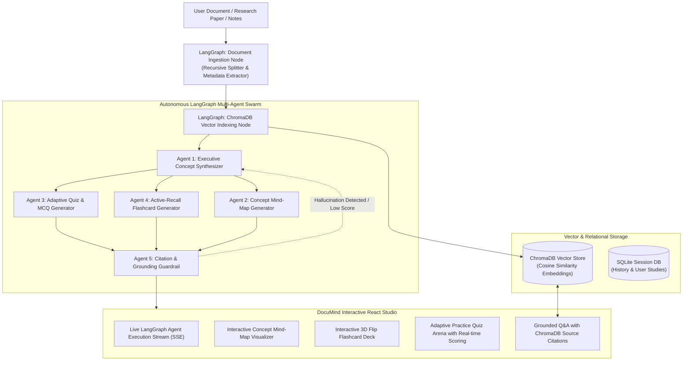

# DocuMind AI 📚⚡
> **Autonomous Multi-Agent Academic Research, Document Intelligence & Learning Platform**  
> *Engineered with LangChain, LangGraph, ChromaDB Vector RAG, FastAPI, and React.*

---

## 🎓 Academic Capstone Overview
**DocuMind AI** is an autonomous multi-agent document intelligence and accelerated learning platform built specifically for academic research papers, textbooks, and technical documentation. 

Instead of simple one-shot LLM document summarizers, DocuMind AI coordinates an autonomous **LangGraph StateGraph** swarm backed by a persistent **ChromaDB vector database** to ingest, index, synthesize, and generate interactive learning tools with strict citation grounding.

---

## 🏛️ System Architecture

---

## 🚀 Key Features

1. **LangGraph Multi-Agent Orchestration**: Directed state graph with cycle reflection loops to guarantee factual fidelity and eliminate hallucinated content.
2. **ChromaDB Vector Retrieval (RAG)**: Chunk-level semantic indexing with metadata tags (page numbers, section headings, similarity scores) for verified citations.
3. **Interactive 3D Flip Flashcard Deck**: Automatically generates active-recall study cards with difficulty filters and progress tracking.
4. **Adaptive Quiz Arena**: Generates multiple-choice and conceptual assessment questions with instant scorecards and detailed answer justifications.
5. **Interactive Concept Mind-Maps**: Auto-generates visual concept hierarchies (Mermaid diagrams) breaking down complex topics into digestible components.
6. **Grounded RAG Assistant**: Ask any follow-up question and get answers with exact source snippets and page/chunk citations from ChromaDB.
7. **Production Full-Stack Architecture**: Built with Python 3.11, FastAPI, SSE real-time streaming, SQLite, React 19, TypeScript, and Tailwind CSS.

---

## 🛠️ Tech Stack

| Layer | Technologies |
|---|---|
| **AI & Orchestration** | LangChain, LangGraph (StateGraph), ChromaDB, Gemini/OpenAI |
| **Backend API** | FastAPI, Python 3.11, Uvicorn, SQLite, SQLAlchemy, Pydantic v2 |
| **Frontend UI** | React 19, Vite, TypeScript, Tailwind CSS, Lucide Icons, Mermaid.js |
| **Testing** | Pytest, Pytest-Asyncio, HTTPX |

---
*Developed by Sivasairohith Uppala (Final Year B.Tech Computer Science)*
