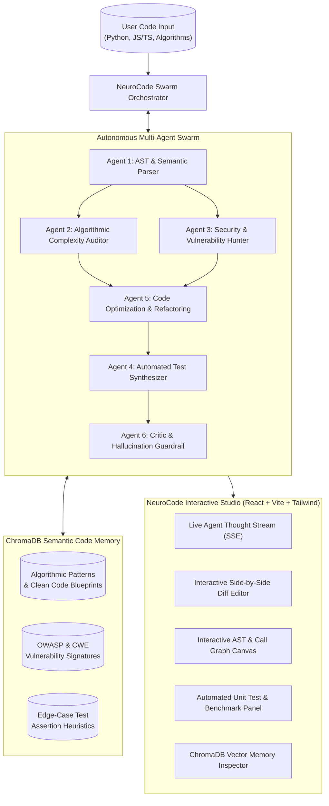

# NeuroCode Studio ⚡🧠
> **Autonomous Multi-Agent Code Intelligence, AST Refactoring, Security Auditing & Self-Healing Test Generation Platform**  
> *Powered by Collaborative Multi-Agent Swarms, ChromaDB Vector Code Memory, Abstract Syntax Tree (AST) Static Analysis, and Hallucination Guardrails.*

---

## 🎓 Academic & Engineering Context
Designed as a capstone-grade Computer Science & AI engineering platform, **NeuroCode Studio** tackles the core challenges of modern software engineering:
1. **Abstract Syntax Tree (AST) Parsing & Semantic Decomposition**: Deep structural code parsing without relying solely on raw text tokens.
2. **Algorithmic Complexity & Profiling**: Automated time & space complexity analysis ($O(1), O(\log N), O(N), O(N \log N), O(N^2), O(2^N)$), recursion depth auditing, and data structure bottleneck detection.
3. **Cybersecurity & Vulnerability Auditing**: OWASP Top 10 detection (SQL injection, XSS, insecure deserialization, path traversal, race conditions, memory leaks).
4. **Vector Retrieval-Augmented Generation (ChromaDB RAG)**: Semantic vector memory indexing algorithmic design patterns, optimal data structure implementations, and known vulnerability signatures.
5. **Multi-Agent Autonomous Orchestration**: A directed pipeline of specialized agents (AST Parser, Complexity Auditor, Security Hunter, Test Synthesizer, Patch Optimizer, and Hallucination Critic).
6. **Automated Edge-Case Test Synthesis**: Deterministic unit test generation targeting edge cases, zero-division, boundary extremes, and null safety.
7. **Production SaaS Studio UI**: Interactive code diff viewer, AST call-graph visualizer, live streaming agent thought trace, and ChromaDB semantic memory inspector.

---

## 🏛️ System Architecture

---

## 🚀 Key Features

- **AST-Aware Structural Code Analysis**: Parses code into an Abstract Syntax Tree to identify control flows, function signatures, nested loops, and variable bindings.
- **Big-O Algorithmic Profiler**: Detects quadratic/exponential time complexity loops, improper data structure selections, and suggests amortized $O(1)$ / $O(N)$ alternatives.
- **OWASP Vulnerability Scanner**: Analyzes code against Common Weakness Enumeration (CWE) and OWASP standards with severity ranking (Critical, High, Medium, Low).
- **ChromaDB Vector Code Memory**: Semantic vector retrieval of battle-tested algorithmic implementations, design patterns, and anti-pattern mitigations.
- **Zero-Shot Test Generation**: Automatically generates production-ready Pytest suites with edge cases, assertion coverage, and mock fixtures.
- **Interactive Visual Diff & AST Explorer**: Real-time side-by-side comparison between original and refactored code with explanatory annotations.
- **Full Offline Fallback + Live LLM Integration**: Operates seamlessly out-of-the-box with heuristic inference, and optionally connects to Google Gemini / OpenAI with API keys.

---
*Built with Python 3.11, FastAPI, ChromaDB, SQLite, React 19, TypeScript, and Tailwind CSS.*
